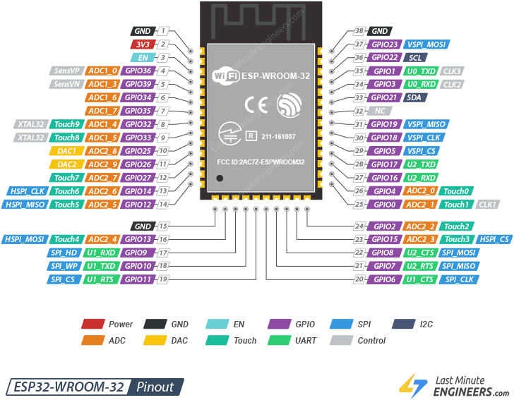

# Phase 1: UART Communication!

## Part 1: Implement UART

Open [src/uart.ino](src/uart.ino) and read the whole file first.
The `readLine()` helper is given to you. Make sure you understand how it builds
up a line one character at a time and why it **never waits** for data.

Then complete the three TODOs:

1. **TODO 1:** In `setup()`, start the `peer` UART at `LINK_BAUD` on pins
   `LINK_RX_PIN` and `LINK_TX_PIN`.
2. **TODO 2:** When the user types a line, send `0:<line>` to `peer` followed
   by `'\n'`, then print `Sent: <line>` to `Serial`. The `0:` is a placeholder
   for a sequence number. Ignore it for now; you will use it in Part 3.
3. **TODO 3:** Check for a complete line from `peer` with `readLine()`. If one
   arrived, print `Received: <line>` to `Serial`.

Useful functions: `peer.begin(...)`, `peer.print(...)`, `Serial.println(...)`.

## Part 2: Test with boards

1. Upload the **same sketch** to both boards.
2. Wire them together:

   ```
   Board A GPIO17 (TX) ───► Board B GPIO16 (RX)
   Board A GPIO16 (RX) ◄─── Board B GPIO17 (TX)
   Board A GND         ──── Board B GND
   ```

   ⚠️ Do **not** connect the 3V3, 5V or VIN pins between boards. Each board is
   powered by its own USB cable.

3. Open a Serial Monitor for each board at **115200 baud** with the line
   ending set to **Newline**. In Arduino IDE 2, each IDE window has one Serial
   Monitor, so open a second window (**File → New Sketch**), select the other
   board's port there, and open its monitor.
4. Type `hello` in one monitor. The other should show:

   ```
   Received: 0:hello
   ```

   Try both directions, and try both boards at the same time.

## Part 3: Sequence numbers

UART has no way to tell you that a message was lost. If a wire comes loose for
a moment, the receiver simply never sees that message. In this part you will
number every message so the receiver can notice when one goes missing.

Every message now looks like this on the wire:

```
<sequence number>:<text>\n
```

For example, the first three messages a board sends are `1:hi`, `2:how are
you`, `3:bye`. Each board numbers its own messages, starting at 1. The `0` you
sent in Part 1 meant "no sequence number".

Change your sketch from Part 1:

1. **Sending.** Add a global counter for the messages this board has sent.
   Before each send, increase it by one, then send `<counter>:<line>` instead
   of `0:<line>`. Print `Sent #<counter>: <line>` to `Serial`.
2. **Receiving.** Split the received line at the first `:` into the sequence
   number and the text. Print `Received #<number>: <text>`. If the line has
   no `:`, or the part before it is not made of digits only, print a warning
   and ignore the message. (Electrical noise, for example from a wire being
   plugged in, can add junk characters to the front of a line. `readLine()`
   already drops non-printable junk, but noise can also look like ordinary
   characters.)
3. **Checking.** Add a global holding the number you expect next (starting at
   1). When a message arrives:
   - If its number is **0**, it has no sequence number (it came from a Part 1
     sketch). Print `Received: <text>` and skip the checks below.
   - If its number is **higher** than expected, print
     `Warning: missed <n> message(s)`.
   - If its number is **lower** than expected, print
     `Warning: duplicate or out-of-order message`.
   - For any number other than 0, the next expected number is then the
     received number + 1 (even after a warning).

Useful functions: `line.indexOf(':')`, `line.substring(start, end)`,
`number.toInt()`, `String(number)`, `isDigit(c)`.

### Test it

1. Send a few messages from board A. Board B should print `Received #1`,
   `Received #2`, and so on with no warnings.
2. Unplug the wire from **board A's GPIO17 (TX)**. Send a message from A, then
   plug the wire back in and send another. Board B should print
   `Warning: missed 1 message(s)`.
3. Press the **EN** (reset) button on board A and send another message from A.
   What does board B print, and why?

## Troubleshooting

| Symptom | Likely cause |
| --- | --- |
| Nothing happens when you press Enter | Serial Monitor line ending is set to "No line ending". Set it to "Newline". |
| Garbage characters in the Serial Monitor | Serial Monitor baud isn't 115200. |
| `Received:` shows garbled text, or nothing arrives at all | Baud rates differ between the boards, or GND isn't connected. (`readLine()` drops non-printable bytes, so bad data often shows up as nothing.) |
| `Sent:` appears but nothing is received | TX/RX not crossed, wrong pins, loose wire, or the other board isn't running the sketch. |
| Upload fails with "Failed to connect" | Hold the **BOOT** button while the upload starts. |
| Board reboots or crashes on start | Some modules (e.g. ESP32-WROVER) use GPIO16/17 internally. Change the pins to 25 and 26. |

## Pinout Reference
 for wiring